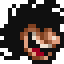
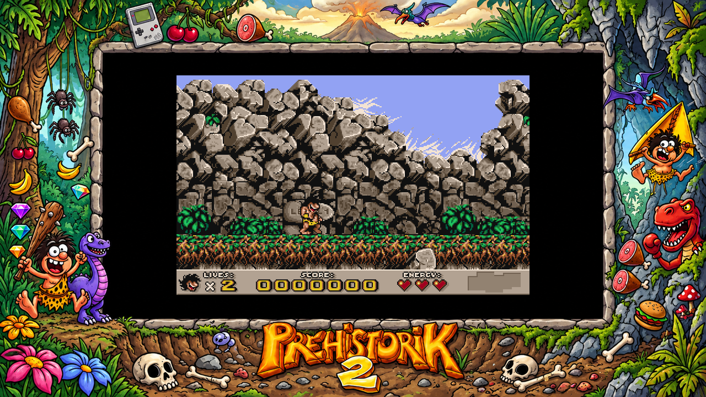
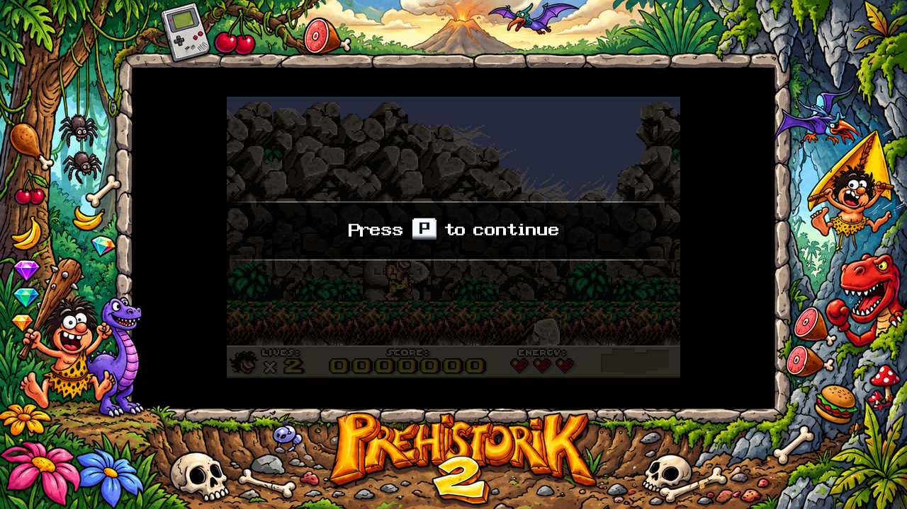

<div align="center">



# 🦖 rustypre2

### **Native, Zero-VM Rust Engine & Multi-Platform Runtime for *Prehistorik 2* (1993)**

[](LICENSE)
[](https://www.rust-lang.org/)
[](#multi-platform-architecture)
[](#pure-rust-audio-synthesizer)
[](#building-from-source)

*A cycle-accurate, allocation-free native Rust reimplementation of Titus Interactive's 1993 DOS platformer classic — running natively on Windows, macOS, and Linux without DOSBox, virtual machines, or external audio DLLs.*

---



<br/>



</div>

---

## 📖 Table of Contents

1. [The Story of *Prehistorik 2*](#-the-story-of-prehistorik-2)
2. [Why Rewrite in Rust?](#-why-rewrite-in-rust)
3. [Core Engineering & Reverse-Engineering Techniques](#-core-engineering--reverse-engineering-techniques)
4. [Multi-Platform Architecture](#-multi-platform-architecture)
5. [Features & Modern Quality-of-Life Enhancements](#-features--modern-quality-of-life-enhancements)
6. [How to Use (Quick Start)](#-how-to-use-quick-start)
7. [Controls & Keyboard Shortcuts](#-controls--keyboard-shortcuts)
8. [Building from Source](#-building-from-source)
9. [Project Structure](#-project-structure)
10. [Changelog](#-changelog)
11. [License & Legal Notice](#-license--legal-notice)

---

## 🌋 The Story of *Prehistorik 2*

Released in **1993** by **Titus Interactive** for MS-DOS and Amstrad CPC, ***Prehistorik 2*** is one of the most technically ambitious and beloved European platformers of the early PC era.

You play as **Sam**, a perpetually hungry caveman armed with nothing but his trusty wooden club (and an upgradable stone mallet), venturing across **10 sprawling prehistoric worlds** — from dense jungles, ancient burial grounds, and perilous tree canopies to frozen glaciers and the dark fortress of the final boss. Along the way, Sam bashes comical dinosaurs, giant spiders, saber-toothed cats, and flying pterodactyls while uncovering hidden caches of burgers, fries, ice cream, giant hams, diamonds, and secret warp tents before winter arrives.

Behind its playful cartoon exterior, the original `PRE2.EXE` pushed 1993 PC hardware to its absolute limit:
- **Hardware-Scrolled 4-Plane EGA Mode `0x0D` (`320×200`, 16-color planar VRAM with 18-bit VGA DAC palettes)** using circular CRTC start-address ring buffers and sub-tile pel-panning for silky-smooth multidirectional scrolling on 286/386 CPUs.
- **Mode `0x13` (`320×200×256`) and Mode `0x12` (`640×480` planar)** high-resolution intro, title, and secret (`YEAR >= 1994` *CREATORS*) screens.
- **Custom `.SQZ` Multi-Codec Compression** combining LZSS, LZW, and Huffman+RLE bitstreams.
- **4-Channel ProTracker `.MOD` Music (`*.TRK`)** mixed in software alongside 8 kHz digital PCM sound effects (`SAMPLE.SQZ`).

---

## 🦀 Why Rewrite in Rust?

While an initial reverse-engineered Python port (`pre2_port`) proved that every routine in `PRE2.EXE` could be recovered from 16-bit x86 real-mode assembly without an CPU emulator, running a per-pixel planar EGA compositor, 12-slot AI walker, and real-time audio mixer inside a Python interpreter introduced inherent overhead, garbage-collection pauses, and heavy runtime dependencies (`pygame`, `numpy`, `libxmp` DLLs, and a full Python distribution).

**`rustypre2`** was built from the ground up in **Rust (2024 Edition)** to achieve:

| Dimension | Legacy DOSBox / Python Port | **rustypre2 (Native Rust)** |
| :--- | :--- | :--- |
| **Execution Model** | Emulated 16-bit CPU or interpreted Python + NumPy | **100% Native Machine Code (`opt-level = 3`, Full LTO)** |
| **Frame Pacing** | Variable sleep jitter under heavy enemy loads | **Microsecond-Accurate Deadline Pacer (`42.857 ms` / `23.333 Hz`)** |
| **Per-Frame Heap Allocations** | ~600 KB/frame temporary arrays & plane copies | **Zero-Allocation Hot Path (`PLANE_POOL` + stack buffers)** |
| **Audio Backend** | External `libxmp.dll` + temporary disk files | **Pure-Rust 44.1 kHz Stereo `.MOD` Synth + PCM Mixer in RAM** |
| **Distribution** | Multi-hundred-megabyte Python environment | **Single ~4 MB Self-Contained Native Executable** |
| **Console Window** | Opens a background terminal window on launch | **Pure GUI Subsystem (`IMAGE_SUBSYSTEM_WINDOWS_GUI`)** |

---

## ⚙️ Core Engineering & Reverse-Engineering Techniques

### 1. Faithful 1 MB Flat Memory & `DGROUP` Segment Architecture
Rather than inventing an approximate clone, `rustypre2` preserves the exact deterministic behavior of `PRE2.EXE`:
- The original 64 KB **`DGROUP` (`0x1A0F`)** data segment image (`assets/dgroup.bin`) and `CS` lookup tables (sine/cosine, jump parabolas, scroll speed curves, and AI dispatch tables) are embedded directly into the binary via `include_bytes!`.
- All 13 object AI handlers (`1030:684E`), player physics & slope collision (`1030:40B3`), secret tile discovery, boss state machines, password encryption (`1030:932F`), and PRNG (`rng_lcg` / `rng_ror`) read and mutate the exact DGROUP offsets of the 1993 executable.

### 2. Zero-Allocation Planar EGA Ring Compositor
- The original game renders into four 64 KB EGA bitplanes (`0xA000:0x0000..0xFFFF`), maintaining a 20×12 tile ring buffer at `0x3F40..0x5E80` and a 256-slot planar tile/sprite cache at `0x5E80..0x7E80`.
- **`rustypre2`** recycles its 4×64 KB EGA planes through a thread-local **`PLANE_POOL`**, eliminating `256 KB` of heap allocation/deallocation per frame.
- **Fast Unrolled Sprite Blitter (`paint_sprite`):** The 5-plane sprite renderer (1 silhouette AND-mask plane + 4 color OR-planes with hardware bit-rotation `ROR` and horizontal bit-reversal) is split into branchless 4-plane mask passes and single-plane OR passes.
- **Lazy Foreground Tile Culling (`read_foreground_state`):** Secret passage foreground tiles (`flag & 0x40`) are pre-screened directly on live memory slices without copying the 64 KB tilemap grid or 64 KB tile graphics buffer unless a sprite actively overlaps a secret passage.

### 3. Pure-Rust Audio Synthesizer (`ModSynth` + Digital PCM)
- All `.TRK` music modules are decompressed in memory via `unpack_sqz` and synthesized in real time at **44,100 Hz 16-bit Stereo** by a custom pure-Rust ProTracker engine.
- Uses authentic **Amiga PAL clock timing (`3,546,895.0 / period`)**, **4-point Catmull-Rom cubic spline resampling**, loop-aware sample wrapping, and anti-click volume ramping.
- Simultaneously mixes the 11 digital 8,000 Hz PCM sound effects from `SAMPLE.SQZ` (including the iconic Titus *"Ugaga!"* voice sample) with stereo spatial panning.

### 4. Enhanced Vertical Camera Follow
- The original DOS vertical camera (`1030:5663`) cleared its active scroll flag (`[0x6BEE]`) the instant the player's vertical velocity reached zero (`yvel == 0`) and used a tight `dxs <= 3` upper trigger row, frequently leaving the camera lagging below the character after platform climbs.
- In live gameplay (while keeping deterministic attract-mode demos 100% untouched), `rustypre2` completes active vertical re-centering smoothly and maintains a balanced `rows 6..8` framing window.

### 5. Deadline-Based 23.333 Hz Runtime Pacer
- The original DOS game locks its simulation to **3 VGA 70 Hz vertical retraces per tick (`70 / 3 = 23.333 Hz` = `42,857,143 ns`)**.
- `rustypre2` tracks an absolute `Instant` deadline per tick, automatically subtracting CPU simulation and rendering time from the wait budget, polling input/window events at `1 ms` intervals during the remaining budget, and spinning for the final `< 2 ms`. Even in scenes packed with enemies, projectiles, and particles, the tick rate never slows down.

---

## 🖥️ Multi-Platform Architecture

`rustypre2` compiles cleanly with **`0 warnings`** across **Windows**, **macOS**, and **Linux**:

```
┌──────────────────────────────────────────────────────────────────────┐
│                         rustypre2 Runtime                            │
├──────────────────────┬───────────────────────┬───────────────────────┤
│   Windows (x86_64)   │  macOS (ARM64/Intel)  │ Linux (x86_64/ARM64)  │
│  GUI Subsystem (PE)  │  Homebrew/Frameworks  │  X11 / Wayland SDL2   │
│  Embedded COFF Icon  │  Opt+Enter / Cmd+Enter│  Case-Insensitive I/O │
└──────────┬───────────┴───────────┬───────────┴───────────┬───────────┘
           │                       │                       │
           ▼                       ▼                       ▼
┌──────────────────────────────────────────────────────────────────────┐
│        Unified SDL2 Video (RGB24 + ABGR8888 Overlay) & Audio         │
└──────────────────────────────────────────────────────────────────────┘
```

- **Case-Insensitive Asset Resolver (`resolve_game_path`):** Linux (`ext4`/`btrfs`) and case-sensitive macOS (`APFS`) filesystems seamlessly load game files whether your GOG/Steam installation names them `SPRITES.SQZ`, `sprites.sqz`, or `Sprites.Sqz`.
- **Self-Contained Windows PE Resource Builder (`build.rs`):** Generates a native COFF `.rsrc` object (`RT_GROUP_ICON` + `RT_ICON`) directly in pure Rust at build time — no external `windres` or `rc.exe` needed.
- **Per-Monitor v2 DPI Awareness:** Prevents OS fractional scaling blur on high-DPI displays.

---

## ✨ Features & Modern Quality-of-Life Enhancements

- 🖼️ **`Alt+Enter` Fullscreen Bezel Overlay Mode:**
  - Press **`Alt+Enter`** (or **`Cmd+Enter`** on macOS) at any time to switch to borderless desktop fullscreen with a custom **1920×1080 prehistoric stone bezel illustration**.
  - The game renders at a crisp, integer-scaled **`960×600`** (`3×` of `320×200`) centered inside the stone viewport without aspect distortion or fractional pixel shimmering.
  - Press **`Alt+Enter`** again to return to the `960×600` window without the overlay.
- ⏸️ **`[P]` Key & Window-Minimize Pause System:**
  - Press **`P`** during gameplay to freeze simulation and real-time audio mixing at the exact sample position.
  - Dimmed viewport pause scene featuring a custom pixel-art **3D `[P]` keyboard keycap** (`Press [P] to continue`).
  - Automatically pauses when the window is **minimized**, and waits on the pause screen when restored until you explicitly press **`P`**.
- 🖱️ **Auto-Hiding Mouse Cursor:**
  - Across Windows, macOS, and Linux (in both windowed and fullscreen modes), the mouse cursor automatically hides after **1.5 seconds** of inactivity and reappears immediately on movement.
- 🔇 **No Background Console Window:**
  - Built with `#![windows_subsystem = "windows"]` so launching `rustypre2.exe` opens the game window directly.

---

## 🚀 How to Use (Quick Start)

### 1. Supplying the Game Data (`*.SQZ`, `*.TRK`)
`rustypre2` requires the original data files from a legal copy of *Prehistorik 2* (available on [GOG.com](https://www.gog.com/) or Steam).

Place the original `.SQZ` and `.TRK` files (such as `SPRITES.SQZ`, `ALLFONTS.SQZ`, `SAMPLE.SQZ`, `LEVEL1.SQZ` .. `LEVELI.SQZ`, `TITUS.SQZ`, `PRESENT.SQZ`, `CASTLE.SQZ`, `CARTE.SQZ`, `MENU.SQZ`, `MOD.TRK`, etc.) into a `game_data/` folder next to the `rustypre2` executable:

```text
rustypre2/
├── rustypre2.exe          (or ./rustypre2 on Linux/macOS)
├── SDL2.dll               (on Windows)
└── game_data/
    ├── ALLFONTS.SQZ
    ├── CARTE.SQZ
    ├── LEVEL1.SQZ
    ├── MOD.TRK
    ├── SAMPLE.SQZ
    ├── SPRITES.SQZ
    └── ...
```

*(Alternatively, you can point to any directory via the `RUSTYPRE2_GAME_ROOT=/path/to/Prehist2` environment variable.)*

### 2. Running the Release Binaries
- **Windows:** Extract `rustypre2-v0.1.0-windows-x86_64.zip`, place your `.SQZ`/`.TRK` files in `game_data/`, and double-click **`rustypre2.exe`**.
- **Linux:** Install SDL2 (`sudo apt install libsdl2-2.0-0`), extract the archive, place game files in `game_data/`, and run `./rustypre2`.
- **macOS:** Install SDL2 (`brew install sdl2`), place game files in `game_data/`, and run `./rustypre2`.

---

## 🎮 Controls & Keyboard Shortcuts

| Key | Action |
| :--- | :--- |
| **Left / Right Arrow** *(or Numpad 4 / 6)* | Move Sam left / right |
| **Up Arrow** *(or Numpad 8)* | Jump / Climb / Enter cave or tent (when combined with Down/Up) |
| **Down Arrow** *(or Numpad 2)* | Crouch / Look down / Enter secret passage |
| **Space** | Swing club / Bash enemies and blocks |
| **Enter** | Confirm menu selection / Advance title screens |
| **`P`** | **Pause / Resume game** (also resumes after window minimize) |
| **`Alt + Enter`** *(or `Cmd + Enter` on macOS)* | **Toggle Fullscreen Overlay Mode ↔ Windowed Mode (`960×600`)** |
| **`0` – `9`, `A` – `F`** | Enter hexadecimal level password on the `ENTER CODE` screen |
| **`Esc`** | Quit game |

---

## 🛠️ Building from Source

### Prerequisites
- **Rust 1.85+** (2024 Edition)
- **SDL2 Development Libraries:**
  - **Ubuntu / Debian:** `sudo apt install libsdl2-dev`
  - **Fedora / RHEL:** `sudo dnf install SDL2-devel`
  - **Arch Linux:** `sudo pacman -S sdl2`
  - **macOS (Homebrew):** `brew install sdl2`
  - **Windows:** Place `SDL2.lib` / `libSDL2.dll.a` in your library path (or build via `cargo-zigbuild`).

### Compile & Run
```bash
git clone https://github.com/murat-saglam/rustypre2.git
cd rustypre2
cargo build --release
```

The optimized binary will be produced at:
- Linux / macOS: `target/release/rustypre2`
- Windows: `target/release/rustypre2.exe`

---

## 📂 Project Structure

```text
rustypre2/
├── assets/
│   ├── dgroup.bin         # 64 KB initial DGROUP (0x1A0F) memory image from PRE2.EXE
│   ├── overlay.png        # 1920x1080 fullscreen stone bezel illustration
│   ├── icon.ico           # Multi-resolution Windows PE executable icon
│   └── icon.png           # Runtime SDL2 window/dock icon
├── src/
│   ├── main.rs            # SDL2 runtime, deadline tick pacer, overlay & pause compositor
│   ├── audio/             # Pure-Rust ProTracker .MOD synthesizer & real-time SDL2 mixer
│   ├── codecs/            # LZSS / LZW / Huffman+RLE .SQZ decompressor & 5-plane sprite bank
│   ├── engine/            # Boot loader, front-end, camera scroll, level state & VGA DAC
│   ├── recovered/         # Disassembled & verified game logic (player, 13 AI handlers, HUD)
│   ├── render/            # Planar EGA Mode 0Dh / 13h / 12h to RGB24 decoder
│   └── views/             # Zero-allocation plane pool, sprite cache & foreground culling
├── build.rs               # macOS SDL2 discovery & pure-Rust Windows COFF icon builder
├── CHANGELOG.md           # Release history
├── Cargo.toml             # Crate manifest (GPL-3.0-only)
└── LICENSE                # GNU General Public License v3.0
```

---

## 📋 Changelog

See [CHANGELOG.md](CHANGELOG.md) for full release notes.

### Highlights in `v0.1.0`
- **Initial Release (`v0.1.0`):** Complete native Rust port of *Prehistorik 2* (`81` source modules, `0` compiler warnings) with bit-exact gameplay physics, all 13 enemy/object AI handlers, bosses, secret passages, and cutscenes.
- **`Alt+Enter` Fullscreen Bezel Overlay Mode:** Toggle between a `960×600` window and desktop fullscreen featuring the custom `1920×1080` prehistoric bezel overlay with a centered `960×600` viewport.
- **`P` Key & Minimize Pause System:** Instant gameplay and audio pause via `P` or window minimization (does not auto-resume on restore; displays a darkened viewport with a 3D `[P]` keycap prompt: `Press [P] to continue`).
- **Performance & Camera Optimization:** Microsecond deadline-based `23.333 Hz` tick pacer, zero-allocation `PLANE_POOL` memory management, improved vertical camera follow, auto-hiding mouse cursor, and embedded executable/window icon.

---

## 📜 License & Legal Notice

- **Engine Source Code (`rustypre2`):** Licensed under the **GNU General Public License v3.0 (`GPL-3.0-only`)**. See [LICENSE](LICENSE) for full details.
- **Original Game Intellectual Property:** *Prehistorik 2* is a trademark and copyright of **Titus Interactive / Interplay Entertainment Corp.** No original copyrighted `.SQZ` or `.TRK` game assets are distributed in this repository; you must provide your own legally acquired copy of the game data to play.
